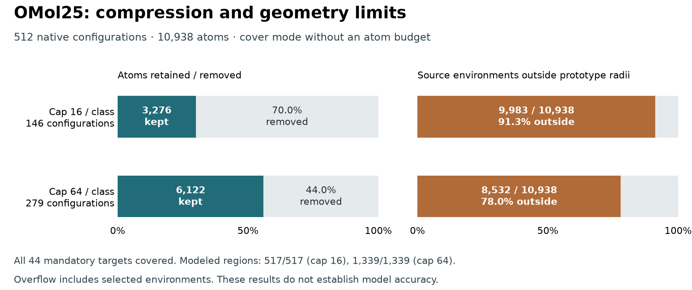

# OMol25 compression demonstration

This example selects a smaller set of intact molecular configurations from
an ordered sample of a local OMol25 4M training archive. It uses finite CHNO
structures with at most 60 atoms, preserving the source coordinates, atom
order, energy/force labels, total charge, spin multiplicity and electronic
metadata. No copied or perturbed structures are added to create redundancy.

The primary configuration uses **cover mode**, with no atom budget or target
retention fraction. It covers the mandatory element/state targets and the
modeled SOAP geometry regions. Source environments outside every prototype
radius are reported separately: complete target coverage does not imply
complete geometric fidelity or retained model accuracy.

This native-archive sample is separate from the [29-record ColabFit smoke
sample](../README.md), rather than an extension of its row ordering. The
earlier accuracy screens and their limitations still apply to those earlier
experiments. For actual model fitting on a split of this native sample, see the
[MACE training comparison](training.md), which evaluates the full training pool,
two EnvTok covers and a random subset on the same held-out configurations.

## Measured results

The default cover run retained **146 of 512 configurations** and **3,276 of
10,938 atoms**: 71.5% fewer configurations and 70.0% fewer atoms. It covered
all **44 mandatory element/state targets** and all **517 modeled geometry
regions**, without a budget forcing that retention fraction.



**This is not full geometric coverage.** With the default prototype cap of
16, **9,983 of 10,938 source environments (91.3%)** lie outside every fitted
prototype radius. That count includes environments in selected configurations;
it is not a count of omitted atoms. Only 30.1% of the original detailed
graph-unknown fallback tokens are retained.

Increasing the prototype cap to 64 provides a sensitivity check on the same
source and SOAP features:

| Prototype cap | Configurations retained | Atoms retained | Atoms removed | Modeled regions covered | Source environments outside prototype radii |
|---|---:|---:|---:|---:|---:|
| 16 (default) | 146 | 3,276 | 70.0% | 517 / 517 | 9,983 / 10,938 (91.3%) |
| 64 | 279 | 6,122 | 44.0% | 1,339 / 1,339 | 8,532 / 10,938 (78.0%) |

Both runs cover all 44 mandatory targets. With cap 64, the mean
nearest-selected SOAP distance falls from 0.16767 to 0.08557, and the 95th
percentile from 0.40978 to 0.29843, on the same deterministic 4,096-environment
audit sample. Neither audit finds a missing compatible class. More prototypes
retain more configurations and improve these distance diagnostics, but the
large remaining overflow prevents a claim of full geometric fidelity.

Using the cover's achieved cost as a **3,276-atom ceiling** for random
sampling, random selections miss mandatory targets and modeled regions:

| Selection | Atoms retained | Mandatory targets covered | Modeled regions covered |
|---|---:|---:|---:|
| EnvTok cover | 3,276 | 44 / 44 | 517 / 517 |
| Random, seed 0 | 3,274 | 42 / 44 | 426 / 517 |
| Random, seed 1 | 3,272 | 43 / 44 | 423 / 517 |
| Random, seed 2 | 3,276 | 40 / 44 | 431 / 517 |

All 512 sampled configurations were eligible, with no ingestion exclusions,
conflicts or merged duplicates. Each sampled configuration passed comparison
against its native source for geometry, atom order, metadata, charge,
multiplicity, energy and forces. The primary run's 146 exported configurations
also passed source comparisons, and frozen-run audit, deterministic restart
and feature-cache reuse checks passed. See [results.json](results.json) for
the recorded diagnostics and verification results.

## Reproduce

From the repository root, prepare the source from an existing local archive:

```bash
uv run --extra omat24 --extra molecular python build_tools/sample_omol.py \
  --archive /path/to/omol25_4M.tar.gz \
  --count 512 --max-atoms 60 \
  --output-directory runs/omol-compression-demo/data

uv run --extra molecular envtok run \
  --config examples/molecular/omol/compression-demo/config.yaml
```

The `omat24` extra supplies the ASE-LMDB reader used by the native sampler;
the `molecular` extra supplies the molecular representation dependencies.
With both installed, replace `uv run --extra omat24 --extra molecular python`
with `.venv/bin/python`, and `uv run --extra molecular envtok` with
`.venv/bin/python -m envtok`.

No dataset is downloaded. The sampler stages only
`train_4M/data0009.aselmdb`, then writes the bounded sample and acquisition
manifest under `runs/omol-compression-demo/data/`. The documented source shard
has SHA-256
`95fd3efd85268d397e3a436ebe265ff7a6206b28f914ded85fb838bc10fe71ea`,
corresponding to configuration revision
`local-4M-shard-95fd3efd85268d39`. Check the generated manifest before using a
different archive release; its revision must match the configuration.

The pipeline prints its selection directory under
`runs/omol-compression-demo/pipeline/molecular-<fingerprint>/`. Open
`report.html` or `coverage.json` there to inspect the audit. `subset.extxyz`
contains the selected original configurations and labels, while
`selected_ids.txt` records their identities. Repeating the run reuses the
committed molecular features.

Run the finer-prototype sensitivity case with:

```bash
uv run --extra molecular envtok run \
  --config examples/molecular/omol/compression-demo/config-geometry64.yaml
```

The saved `results.json` and chart record the demonstrated runs. New runs
write reports under `runs/` without replacing that snapshot.

## Budget comparisons

Compare stratified random, token-only and combined selection at 25% and 50%
atom ceilings, with a separate full-pool control:

```bash
uv run --extra molecular envtok benchmark \
  --config examples/molecular/omol/compression-demo/config.yaml \
  --fractions 0.25 0.5 --seeds 0
```

These are budget diagnostics, separate from the unrestricted cover run.
Read actual achieved atom counts, `complete` and `unmet_constraints` for each
selection. The comparison harness adds shared state/size strata, so its
mandatory-target count is **64**, including 20 additional strata, rather
than the primary run's 44. The recorded seed-0 comparisons are:

| Atom ceiling | Selector | Configurations | Atoms retained | Mandatory targets covered | Modeled regions covered |
|---|---|---:|---:|---:|---:|
| 25% (2,734 atoms) | Stratified random | 109 | 2,734 | 62 / 64 | 407 / 517 |
| 25% (2,734 atoms) | Token-only | 111 | 2,733 | 64 / 64 | 421 / 517 |
| 25% (2,734 atoms) | Combined | 134 | 2,720 | 64 / 64 | 502 / 517 |
| 50% (5,469 atoms) | Stratified random | 222 | 5,460 | 63 / 64 | 471 / 517 |
| 50% (5,469 atoms) | Token-only | 226 | 5,466 | 64 / 64 | 468 / 517 |
| 50% (5,469 atoms) | Combined | 146 | 3,283 | 64 / 64 | 517 / 517 |

`complete: true` certifies the **mandatory targets only**, not the modeled
geometry regions. Thus the 25% combined run is complete in that sense while
missing 15 regions. An atom budget is a ceiling, not a quota: the 50% combined
run stops at 3,283 atoms after covering its targets and modeled regions.
The benchmark uses a different target set, so its selected atoms need not
match the primary cover run. Results are saved in
`benchmarks.json` and the `benchmarks/` subdirectory of the selection run.

## Coverage and geometry

The configuration rejects unknown charge or multiplicity and preserves both
through coarsening and export. It keeps the smoke example's SOAP species
H/C/N/O and hierarchy support threshold 5. No bond graph is supplied, and
automatic graph perception remains disabled, so the example explicitly
uses the graph-unknown channel; it does not establish coverage of molecular
bond graphs.

The default geometry refinement uses radius 0.20, at most 16 prototypes and a
reservoir of at most 256 environments per fitted class. The audit distinguishes:

- Mandatory element/state targets and modeled geometry regions covered by
  selected records.
- `geometry_overflow_environments`: source environments outside every fitted
  prototype radius, including any such environments in selected records.
- Nearest-selected descriptor distances for a deterministic sample of at most
  4,096 environments. These are dimensionless normalized-SOAP distances,
  with missing compatible classes counted explicitly.

## Source and limitations

The sampler maps native `charge` to `total_charge` and native `spin` to
`spin_multiplicity`. Stored energy and force labels use eV and eV/angstrom.
Original native metadata is preserved, and acquisition provenance records
the archive, member and sample hashes, source row identities, filtering and
state counts. The label namespace is `OMol25:native-4M`; absent per-record
method fields are not manufactured.

The ordered sampler read the first **1,818 native rows**, excluding 1,159
with elements outside CHNO and 147 above 60 atoms, to retain 512
configurations / 10,938 atoms. Those records contain ten supplied
charge/multiplicity combinations; no artificial states were generated.

The local archive's upstream checksum has not been independently verified.
This is an ordered sample of small CHNO configurations from one training
shard, not a random or representative dataset benchmark. No verified
parent-family mapping is asserted: the pipeline reports uncertainty and uses
its conservative composition fallback for grouping. Geometry/state coverage
alone does not establish predictive accuracy.

Source data are **CC BY 4.0**. Cite Levine et al., *The Open Molecules 2025
Dataset, Evaluations, and Models*, [arXiv:2505.08762](https://arxiv.org/abs/2505.08762).
The [official OMol25 repository](https://huggingface.co/facebook/OMol25)
describes the original dataset.
