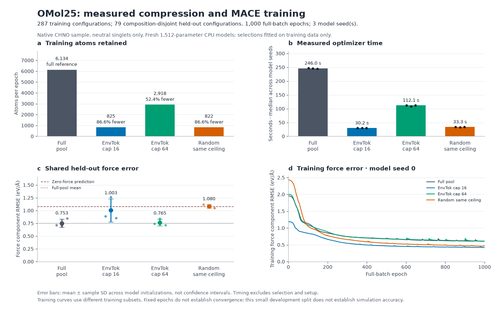

# OMol25 compression with actual MACE training

This experiment measures how selecting fewer training configurations changes
training cost and held-out prediction errors. It uses the [512-configuration
native OMol25 sample](README.md), fits fresh MACE models, and compares the full
training pool with two EnvTok covers and a random subset.

The split is made **before selection**. The original 146-configuration cover
from the unsplit compression example is not reused: it has already seen every
configuration that could enter a holdout.

## Measured training results

All **12 fresh MACE training runs completed**. The finer EnvTok cover used
**52.4% fewer training atoms** and reduced median fit time from **246.0 to
112.1 seconds**. Its mean held-out force RMSE was **0.765 versus 0.753
eV/angstrom** for the full pool, about 1.7% higher. This is a measured cost
reduction with similar average force error in this small experiment;
performance varied across model seeds.



Errors below are mean ± sample standard deviation across model seeds 0, 1 and
2, using the same 79 held-out configurations. Fit time is the median of those
three runs and covers the optimization loop only.

| Training selection | Training atoms | Median fit time (s) | Force RMSE (eV/angstrom) | Energy RMSE (eV/atom) |
|---|---:|---:|---:|---:|
| Full pool | 6,134 | 246.0 | 0.7527 ± 0.0824 | 0.1243 ± 0.0036 |
| EnvTok, cap 16 | 825 | 30.2 | 1.0028 ± 0.2271 | 0.1185 ± 0.0317 |
| EnvTok, cap 64 | 2,918 | 112.1 | 0.7653 ± 0.0679 | 0.1328 ± 0.0088 |
| Stratified random | 822 | 33.3 | 1.0798 ± 0.0341 | 0.2158 ± 0.0089 |

The aggressive cap-16 cover removed 86.6% of training atoms and achieved a
median paired fit speedup of 8.11×, but its mean force error increased by
33.2%. One seed was worse than the zero-force baseline. The cap-64 cover's
median paired fit speedup was 2.20×, and all three models beat both their
initial force predictions and the zero-force baseline. Its mean energy error
per atom was about 6.9% higher than the full-pool result.

**Neither EnvTok setting passes the within-10%-of-full force-error screen
for every paired seed.** Dividing each subset's force RMSE by that of the
full-pool model with the same seed gives:

| Selection | Seed 0 ratio | Seed 1 ratio | Seed 2 ratio | Seeds at or below 1.10 |
|---|---:|---:|---:|---:|
| EnvTok, cap 16 | 1.251 | 1.810 | 1.007 | 1 / 3 |
| EnvTok, cap 64 | 1.042 | 1.205 | 0.840 | 2 / 3 |
| Stratified random | 1.567 | 1.538 | 1.237 | 0 / 3 |

These runs demonstrate reduced training data and compute, and quantify the
associated prediction changes. They do not establish a reliable compression
ratio at retained accuracy. The models are tiny, convergence is not established,
and three initializations on one development split do not demonstrate
statistical equivalence or simulation accuracy. The chart's training-force
curves use seed 0 and different training subsets; they are not held-out
learning curves. See [training-results.json](training-results.json) for all
per-seed errors, training traces, coverage, timings and provenance.

## Frozen training and development data

The MACE model uses positions and elements without charge or spin inputs, so
the experiment uses the sample's **366 neutral singlets / 7,640 atoms**.
The other 146 configurations remain part of the selection-only example.
With split seed `20261105`, conservative composition grouping assigns:

| Partition | Configurations | Atoms | Distinct compositions |
|---|---:|---:|---:|
| Training | 287 | 6,134 | 215 |
| Development holdout | 79 | 1,506 | 59 |

Training and holdout have no shared compositions or record IDs. H, C, N and O
are present in both partitions. Selection targets, SOAP prototypes and atomic
reference-energy fits use training records only. The same 79 held-out records
are evaluated for every model.

The split is an internal development split of source-training data, not an
official OMol25 test partition. Composition grouping reduces conformer leakage,
but no verified reaction or trajectory-family mapping is available.

## Training subsets

Both EnvTok settings use unrestricted cover mode, SOAP radius 0.20, a reservoir
of at most 256 environments per fitted class, and hierarchy support threshold
5. Only the prototype cap changes. The random subset uses fixed selection seed
0, stratifies by state and size, and fills the cap-16 cover's achieved atom
ceiling with intact configurations.

| Selection | Configurations | Training atoms | Atoms removed | Mandatory targets covered | Modeled regions covered |
|---|---:|---:|---:|---:|---:|
| Full pool | 287 | 6,134 | 0.0% | 6 / 6 | 66 / 66 |
| EnvTok, cap 16 | 47 | 825 | 86.6% | 6 / 6 | 66 / 66 |
| EnvTok, cap 64 | 146 | 2,918 | 52.4% | 6 / 6 | 258 / 258 |
| Stratified random | 33 | 822 | 86.6% | 6 / 6 | 19 / 66 |

The full-pool and random coverage figures use the cap-16 target set; the
cap-64 run has its own finer target set. **These counts do not establish full
geometric coverage.** Respectively, 5,938 / 6,134 (96.8%) and 5,583 / 6,134
(91.0%) source environments lie outside all fitted prototype radii. These
counts include environments in selected configurations. Prediction errors must
be measured separately.

## Matched models and measurements

The runner trains **12 models**: four selections with model seeds 0, 1 and 2.
Each is a fresh, small **1,512-parameter MACE model**, with one interaction,
eight scalar channels, cutoff 4.5 angstrom, and correlation order 2. Every model
uses float64, one CPU thread, Adam at learning rate 0.01, and **1,000 full-batch
epochs**. No pretrained model or dataset is downloaded.

The loss is mean squared energy error per atom plus mean squared force
component error. Element reference energies are fitted using only the chosen
training records; all four composition matrices have full rank. The final
fixed epoch is evaluated, without choosing a checkpoint, seed or setting from
holdout errors. Held-out structures are loaded by the training worker only
after the final checkpoint is saved.

Equal full-batch epochs give the same number of optimizer updates. They process
different atom counts: 6,134,000 for the full pool, 825,000 for cap 16,
2,918,000 for cap 64, and 822,000 for random. Training runs execute sequentially
to reduce timing interference. Fit time covers the optimization loop; it
excludes selection, imports, model setup, checkpoint writing and evaluation.
Selection timings and feature-cache status are reported separately.

The original 12-run execution took 21.8 minutes including setup. The saved
aggregate was regenerated during a verified 9.1-second checkpoint replay:
its `elapsed_seconds` measures that replay, while each `fit_seconds` retains
the original measured optimization time. All checkpoint and prediction files
were unchanged by the replay.

Energy RMSE per atom averages squared configuration energy errors after
dividing each by its atom count. Force RMSE averages squared Cartesian
component errors across all held-out atoms. Means and sample standard deviations
across the three model seeds measure initialization variation, not uncertainty
across datasets or splits. The random selection itself is fixed across seeds.

The report also compares held-out force errors with each initial model and
with the zero-force baseline, whose RMSE is **1.076855 eV/angstrom**. A
within-10%-of-full relative screen is recorded separately from absolute model
skill. Passing it does not establish convergence or simulation accuracy.

## Reproduce

First [prepare the native source sample](README.md#reproduce) from an existing
local OMol25 archive. Keep the documented filename and sampling parameters to
reproduce the recorded split and source identities. From the repository root,
run the orchestrator in the EnvTok molecular environment, passing an existing
MACE interpreter:

```bash
uv run --extra molecular python build_tools/benchmark_omol_compression_training.py \
  --mace-python /path/to/mace/python
```

For an already installed EnvTok environment, replace
`uv run --extra molecular python` with `.venv/bin/python`.
MACE and PyTorch remain separate from EnvTok's selection dependencies. The
recorded worker environment uses `mace-torch 0.3.14`, `torch 2.14.1`,
`e3nn 0.4.4`, `ase 3.29.0` and `numpy 2.5.4`.

The default inputs are
`runs/omol-compression-demo/data/sample.extxyz`, with label namespace
`OMol25:native-4M`, and source SHA-256
`325d27bc565b925a7eded46690c1c7016cd22ac5d5c677dacde540fcd5175ddb`.
The script accepts `--source`, `--workdir`, `--output` and `--steps` for explicit
variants, with a maximum of 1,024 source records. Different source identities
or settings constitute a different experiment.

Outputs under `runs/omol-compression-training/` include the frozen split and
source-ID mapping, exact training and holdout exports, selection coverage,
per-seed jobs, model state checkpoints, initial/final predictions, training
loss traces, timing and software metadata. SHA-256 hashes cover inputs,
scripts, checkpoints and results. Completed jobs are reused only when the
recorded job, worker, input files, interpreter path, result and checkpoint
checks match; saved software versions should also be checked when reusing an
environment after upgrading packages.

The default aggregate snapshot is written to `training-results.json` beside
this document. Recreate its chart with:

```bash
uv run --with matplotlib python build_tools/plot_omol_compression_training.py
```

The plotting helper accepts `--input` and `--output` overrides. Its defaults
read `training-results.json` and write `training.png` beside this document.
The underlying dataset and model checkpoints stay under the
ignored `runs/` directory. Source attribution and acquisition limitations are
documented in the [compression example](README.md#source-and-limitations).
