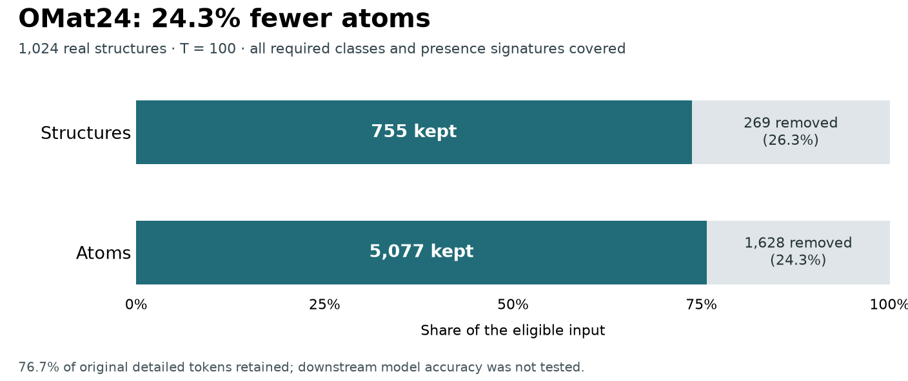

# OMat24 compression demonstration

This example expands the bundled 32-record demonstration to **1,024 real
training structures / 6,705 atoms** from the same native OMat24 rattled-relax
shard. Every retained structure has a distinct supplied parent ID. No copied
or perturbed structures are added to create redundancy.

The ordered scan reads the first 1,526 native rows, excluding 453 records
under the study's La–Lu/Ac–Lr policy, 38 above the 20-atom limit, and three
with a previously retained parent. Eight additional development records have
disjoint parents and are unused by this demonstration. They come from the
official training partition, not the official validation set.

## Measured results

The default T=100 run retained **755 of 1,024 structures** and **5,077 of
6,705 atoms**, removing 269 structures (26.3%) and 1,628 atoms (24.3%). All
1,024 source structures were eligible, with zero processing failures.



| T | Structures retained | Atoms retained | Atoms removed | Distinct full-token coverage |
|---|---:|---:|---:|---:|
| 2 | 855 | 5,628 | 16.1% | 85.7% |
| 10 | 767 | 5,114 | 23.7% | 77.5% |
| 30 | 757 | 5,089 | 24.1% | 76.8% |
| 100 | 755 | 5,077 | 24.3% | 76.7% |

Even at the small example's original T=2 setting, the larger pool removes
16.1% of the atoms. The measured compression comes from overlapping
environment coverage among real source structures; the sampler keeps
distinct parent IDs and does not add artificial duplicates.

Every row passed the independent audit with **100% class and presence
coverage**. At T=100 this means 63/63 fitted classes, plus all 1,159
element/polyhedron, 751 element/coordination, 1,133
element/coordination/compression and 1,541 element/coordination/asymmetry
signatures. The exported 755 frames passed source comparisons for geometry,
atom order, metadata, energies, forces and stresses.

Random subsets with seeds 0, 1 and 2 retained 5,077, 5,076 and 5,077 atoms.
They also covered all 63 coarse classes, but missed 472, 486 and 452 required
presence signatures respectively, counted separately within each family.
EnvTok missed none. These counts sum family-specific omissions; they are
not a deduplicated total across families. Full-token coverage above uses the
5,615 distinct original tokens as its denominator.

See [results.json](results.json) for exact counts, audit details and the
random comparisons.

## Reproduce

From the repository root, sample an existing local archive. No dataset is
downloaded; samples, provenance, caches and results are written under `runs/`.
The saved `results.json` and chart in this example record the demonstrated
run; new runs write their reports under `runs/` without replacing that snapshot.

```bash
uv run --extra omat24 python build_tools/sample_omat24.py \
  --archive /path/to/omat24_1M.tar.gz \
  --train 1024 --development 8 --max-atoms 20 \
  --output-directory runs/omat24-compression-demo/data

uv run --extra omat24 envtok run \
  --config examples/omat24/compression-demo/config.yaml

uv run --extra omat24 envtok sweep \
  --config examples/omat24/compression-demo/config.yaml \
  --min-support 2 10 30 100
```

With the dependencies already installed, replace `uv run --extra omat24 python`
with `.venv/bin/python`, and `uv run --extra omat24 envtok` with
`.venv/bin/python -m envtok`.

The default run uses **T = 100**, eight workers and the reference presence
constraints. The sweep reuses tokenisation and writes `sweep_summary.json`
under `runs/omat24-compression-demo/pipeline/`. Each selection directory
contains `coverage.json`, `report.html` and the selected IDs; the `run` command
also writes `subset.extxyz` with original structures and labels.

For random subsets with the same atom budget, replace `<fingerprint>` with
the suffix printed by the run:

```bash
uv run --extra omat24 envtok baseline \
  --run "runs/omat24-compression-demo/pipeline/selection-T100-<fingerprint>" \
  --seeds 0 1 2
```

## Interpret the results

Compare retained structures **and** atoms with the eligible input pool. The
independent audit checks all fitted coverage classes and all four reference
presence families. Full-token coverage is reported separately: keeping every
coarsened class does not require keeping every original detailed token.

T controls the distinct-structure support required before preserving token
detail, rather than a target retention percentage. Increasing T need not
reduce selected atoms monotonically, so compare all sweep results. Random
baselines use each selection's frozen class mapping and atom count.

This is an ordered sample of small cells from one training shard. It
demonstrates measured compression and coverage on this pool; it does not
establish representative dataset-wide compression or downstream model
accuracy. Source data are CC BY 4.0; the acquisition manifest records hashes,
native row identities and the OMat24 citation. See the [small-sample
provenance notes](../small-sample/README.md) for the archive's origin and
checksum limitations.
