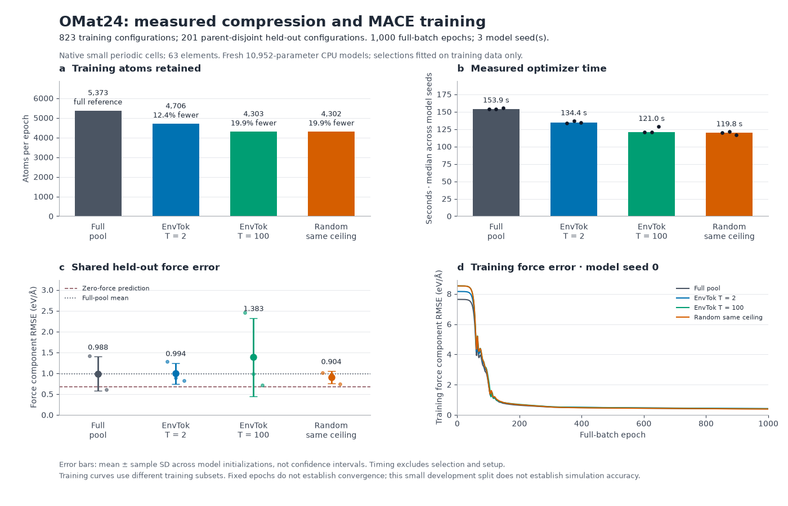

# OMat24 compression with actual MACE training

This experiment measures training cost and held-out prediction errors after
compressing the [1,024-structure native OMat24 sample](README.md). It compares
fresh periodic MACE models fitted on the full training pool, EnvTok covers
at T=2 and T=100, and a random subset at the T=100 cover's atom ceiling.

The development split is frozen **before tokenisation and selection**.
The 755-structure cover from the unsplit compression example is not reused:
its fitted classes and presence signatures have already seen the whole pool.

## Measured training results

All **12 fresh periodic MACE fits completed**. EnvTok T=2 used **12.4% fewer
training atoms**, reducing median optimization time from **153.9 to 134.4
seconds**. T=100 used **19.9% fewer atoms** and took **121.0 seconds**. The
median paired fit speedups were **1.15×** and **1.27×**, respectively.
These figures exclude the 166.8-second cold tokenisation cost described below.

**The accuracy result is weak and unstable.** Mean held-out force RMSE is
higher than the **0.6702 eV/angstrom zero-force baseline for every method**.
Only one of the 12 trained models, full-pool seed 2, beats both zero forces
and its initial force predictions. Training loss decreases do not establish
useful held-out force accuracy in this experiment.



Errors are mean ± sample standard deviation across model seeds 0, 1 and 2
on the same 201 held-out structures. Timing is the median optimizer-loop time.

| Training selection | Training atoms | Median fit time (s) | Force RMSE (eV/angstrom) | Energy RMSE (eV/atom) |
|---|---:|---:|---:|---:|
| Full pool | 5,373 | 153.9 | 0.9884 ± 0.4086 | 0.6476 ± 0.0093 |
| EnvTok, T=2 | 4,706 | 134.4 | 0.9939 ± 0.2490 | 0.6934 ± 0.0279 |
| EnvTok, T=100 | 4,303 | 121.0 | 1.3829 ± 0.9401 | 0.7183 ± 0.0335 |
| Random | 4,302 | 119.8 | 0.9037 ± 0.1471 | 0.7313 ± 0.0266 |

T=2's mean force error is 0.6% higher than the full-pool mean, while its mean
energy error per atom is 7.1% higher. The similar average force error conceals
a 35.4% force-error increase for model seed 2. T=100 raises mean force error
by 39.9% and mean energy error per atom by 10.9%; its seed-0 force RMSE is
2.4570 eV/angstrom.

At the T=100 atom ceiling, random sampling has lower average force error
than T=100 despite missing required presence signatures. Its mean force
error still exceeds zero forces. This result does not establish a general
selector ranking; it shows that complete fitted coverage alone does not
ensure a useful predictive model.

**Neither EnvTok setting meets the within-10%-of-full force-error criterion
for every paired seed.** Ratios below divide each subset's force RMSE by
that of the full-pool model with the same initialization seed:

| Selection | Seed 0 ratio | Seed 1 ratio | Seed 2 ratio | Seeds at or below 1.10 |
|---|---:|---:|---:|---:|
| EnvTok, T=2 | 0.902 | 0.938 | 1.354 | 2 / 3 |
| EnvTok, T=100 | 1.734 | 1.040 | 1.176 | 1 / 3 |
| Random | 0.711 | 1.026 | 1.218 | 2 / 3 |

The full-pool force errors themselves range from 0.6037 to 1.4172 eV/angstrom.
Relative retention against this inconsistent reference is insufficient for an
accuracy claim. The runs demonstrate reduced training input and optimizer
cost, but do not establish a reliable compression ratio at retained accuracy.
The model is small, the force distributions differ sharply across the split,
and convergence is not established. Three seeds on one internal development
split do not establish statistical equivalence or simulation accuracy.

See [training-results.json](training-results.json) for all per-seed errors,
initial predictions' metrics, loss traces, coverage, graph counts, timings
and provenance. The plotted training curves use seed 0 and different
training subsets; they are not held-out learning curves.

## Frozen training and development data

The input contains 1,024 structures with distinct supplied `parent_id` values.
For each parent, the runner hashes `20261105:<parent_id>` with SHA-256 and
assigns values below 0.20 of the hash range to development holdout. This gives:

| Partition | Structures | Atoms | Elements |
|---|---:|---:|---:|
| Training | 823 | 5,373 | 63 |
| Development holdout | 201 | 1,332 | 63 |

Parent identities and record IDs are disjoint across the two partitions.
Every held-out element is present in training. The same 201 held-out
structures are evaluated for every model. Tokenisation, fitted coverage
classes, required-presence signatures and elemental reference-energy fits
use training structures only.

These are internal development partitions of the official training source,
not the official OMat24 validation or test sets. The eight additional
development records from the acquisition sampler remain unused. Parent
separation uses the supplied source identifiers; it is not a guarantee of
composition, prototype or structural dissimilarity.

The labels have a substantial force imbalance: the training force-component
RMS is **7.6346 eV/angstrom**, while the holdout RMS is **0.6702 eV/angstrom**.
The largest training force component has magnitude **429.93 eV/angstrom**
(largest atomwise force-vector norm: 554.80 eV/angstrom). These original labels
are retained without clipping, outlier removal or selecting a different
split after seeing model errors. This limits how much this small, ordered
sample can establish about general OMat24 accuracy.

## Coverage and comparison subsets

EnvTok uses the reference periodic tokenizer and all four reference-presence
families. Both selections use unrestricted cover mode. T controls the
distinct-structure support required before retaining token detail; it is
not an imposed compression percentage. The two settings fit their own
coverage classes using the same training pool.

| Training selection | Structures | Atoms | Atoms removed | Fitted classes covered | Detailed tokens retained | Required presence signatures covered |
|---|---:|---:|---:|---:|---:|---:|
| Full pool | 823 | 5,373 | 0.0% | 63 / 63 | 100.0% | 4,261 / 4,261 |
| EnvTok, T=2 | 721 | 4,706 | 12.4% | 1,512 / 1,512 | 89.4% | 4,261 / 4,261 |
| EnvTok, T=100 | 648 | 4,303 | 19.9% | 63 / 63 | 81.3% | 4,261 / 4,261 |
| Random | 660 | 4,302 | 19.9% | 63 / 63 | 80.2% | 3,930 / 4,261 |

The full-pool and random class counts use the T=100 mapping. Detailed-token
coverage uses the same 4,523-token training vocabulary for every row. Both
EnvTok covers preserve all 1,035 element/polyhedron, 730 element/coordination,
1,065 element/coordination/compression and 1,431
element/coordination/asymmetry signatures. The table sums these four families;
4,261 is a family-tagged count, not a deduplicated count across families.
Random omits 331 family-tagged signatures despite covering all 63 coarse classes.

All 823 training structures passed tokenisation, with zero processing failures.
The tokenizer reports defaulted magnetic moments for every training structure;
these defaults do not establish the source magnetic states.

The random selection uses fixed selection seed 0 and the achieved T=100
atom count as its ceiling, retaining intact source structures. Model seeds
change initial weights, while each method's selected structures stay fixed.
Consequently, the three model seeds do not measure random-selection variance.

Every selection retains the five largest-force source records. Force-component
RMS is 8.1572 eV/angstrom for T=2, 8.5282 for T=100 and 8.5240 for random,
compared with 7.6346 for the full pool. Compression therefore does not remove
the extreme labels or make these three subsets low-force training sets.

Complete fitted-class and required-presence coverage does not imply retained
prediction accuracy. Detailed token coverage and random coverage omissions
are reported separately from the learned model errors.

## Matched periodic models

The runner fits **12 models**: four training selections with model seeds
0, 1 and 2. Each is a fresh **10,952-parameter MACE model** with 63 elements,
one interaction, eight scalar channels, correlation order 2 and a
4.5-angstrom cutoff. All models use float64, Adam at learning rate 0.01,
**1,000 full-batch epochs** and four CPU threads. The thread count was chosen
from a short hardware timing pilot, before inspecting training-comparison
holdout errors; all reported comparisons use the same thread count.

MACE uses the full source cell and periodic boundaries, including neighbors
across cell boundaries and periodic images. The saved graph diagnostics
record directed edges, periodic-image edges and mean neighbors per atom.
Atom savings need not translate proportionally into time savings because
the selected cells can have different neighbor counts.

The loss is mean squared energy error per atom plus mean squared Cartesian
force-component error. It uses stored raw energies and forces, without
substituting Materials Project corrected energies. Element reference energies
are fitted separately using only each chosen training subset, with a
full-rank elemental-count matrix required before training.

Stress labels, available source magnetic metadata, atom order, cells and source
coordinates are preserved in the exports. This model does not train on stress
or condition on magnetic state. No pretrained weights or dataset are
downloaded. The final fixed epoch is evaluated; no checkpoint, seed or setting
is chosen from held-out errors. The worker loads held-out geometry only after
the final model checkpoint has been saved.

Independent export checks verified all 1,024 source-identity mappings and
3,053 exported configuration occurrences across the four training selections
and shared holdout. Cells, periodic boundaries, atom order, source arrays,
metadata and stored energy/force/stress results matched the original sample.

Equal full-batch epochs give equal optimizer-update counts but process
different numbers of atoms and periodic edges. Runs execute sequentially.
Fit time measures the optimizer loop, excluding tokenisation, selection,
imports, setup, checkpoint writing and evaluation. Selection timing and cache
reuse are reported separately.

Cold tokenisation of the 823 training structures took **166.8 seconds**;
the T=2 and T=100 cover selections then took about 0.29 and 0.38 seconds.
The training invocation reused that token cache, so its recorded tokenisation
time is only about 0.014 seconds. Fit-only speedups exclude the cold
preparation cost: these measurements do not establish a one-off end-to-end
speedup. The preparation cost can be shared across repeated model fits.

Energy RMSE per atom averages squared configuration energy errors after
dividing each by its atom count. Force RMSE averages squared Cartesian
component errors across all held-out atoms. Means and sample standard
deviations across model seeds describe initialization variation, not
confidence intervals over datasets or splits.

The comparison includes each initial model and the zero-force baseline
(**0.670201 eV/angstrom**). A within-10%-of-full force-error screen is checked
for each paired model seed, separately from absolute predictive skill.
Passing this engineering screen would not establish convergence or
simulation accuracy.

## Reproduce

First [prepare the native sample](README.md#reproduce) from an existing local
OMat24 archive. From the repository root, run the orchestrator in the EnvTok
environment and pass a separate, existing MACE Python interpreter:

```bash
uv run --extra omat24 python build_tools/benchmark_omat_compression_training.py \
  --mace-python /path/to/mace/python
```

With dependencies already installed, replace `uv run --extra omat24 python`
with `.venv/bin/python`. MACE and PyTorch remain outside EnvTok's selection
dependencies. The recorded worker environment uses `mace-torch 0.3.14`,
`torch 2.14.1`, `e3nn 0.4.4`, `ase 3.29.0` and `numpy 2.5.4`.

The source is `runs/omat24-compression-demo/data/train.extxyz`, with SHA-256
`aff4e6e0b5cb1e5bcfc8bf20e58d86f88a883a4606e329a1b6faf0108436a69a`.
Its acquisition revision is `local-1M-shard-d7be82771964f041`. The source
archive's upstream checksum was not independently verified; the acquisition
manifest records the local archive, shard and sample hashes.

The runner saves the frozen split, exact training and holdout exports,
coverage audits, jobs, checkpoints, initial/final predictions, training-loss
traces, timings, software versions and file hashes under `runs/`. The default
aggregate snapshot is written to `training-results.json` beside this document.
The underlying source dataset and checkpoints remain in the ignored `runs/`
directory.

Use `--prepare-only` to create the split and selections without fitting models.
The runner also accepts `--source`, `--workdir`, `--output`, `--steps`,
`--threads` and `--workers`; variants use different experimental settings.
`--workers` controls tokenisation processes, while `--threads` controls each
MACE fit. Completed training jobs can reuse verified checkpoints, with the
reuse count and invocation time recorded separately from original fit times.

Generate the measured chart without retraining:

```bash
uv run python build_tools/plot_omat_compression_training.py
```

This writes `training.png` beside the aggregate snapshot. Source attribution
and the ordered small-cell acquisition limitations are documented in the
[compression example](README.md#interpret-the-results).
